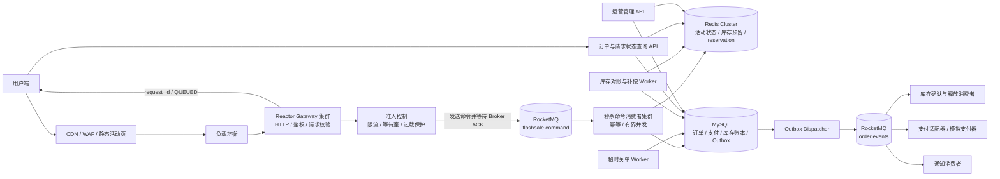

# 高并发电商秒杀服务：执行框架

本文把项目目标、目标架构、模块边界、核心链路、数据约束、实施顺序和验收标准固定下来，作为后续实现与评审的执行基线。

## 1. 项目目标

实现一个可运行、可压测、可恢复的高并发秒杀服务：在突发流量下快速受理请求，通过消息队列削峰，由 Redis 原子预留活动库存，由 MySQL 保存订单和库存账本，并通过 RocketMQ、幂等、重试、补偿和对账完成异步处理。

本项目聚焦秒杀，不实现通用商城、购物车、搜索、优惠券、物流平台。支付可先提供模拟支付适配器，但订单支付、超时关闭和库存释放必须形成完整闭环。

### 1.1 核心目标

- 入口网络层不被慢业务操作阻塞。
- 抢购命令先可靠进入队列，再异步处理。
- Redis 对同一库存操作原子执行，库存不超卖。
- 重复 HTTP 请求、MQ 重投和消费者重启不会创建重复订单或重复扣减库存。
- 订单、支付、库存状态有明确状态机和持久化记录。
- 失败请求可重试、补偿、进入 DLQ 或通过对账修复。
- 容量结论来自目标部署环境的全链路压测，不从单接口数据推断。

### 1.2 设计边界

- RocketMQ 是请求缓冲和事件传递系统，不是订单最终账本。
- MySQL 是订单、支付和库存账本的持久化系统，不作为高并发入口队列。
- Redis 是库存快速准入与 reservation 状态的执行层；Redis 与 MySQL 不构成分布式事务。
- 本地开发 Compose 证明可复现性，不等于生产级集群、高可用或容量结论。

## 2. 目标架构



## 3. 组件职责

| 组件 | 职责 | 关键约束 |
|---|---|---|
| Reactor Gateway | HTTP 接入、协议边界、认证、路由、请求 ID | EventLoop 不执行阻塞 Redis/MySQL 调用；慢任务经有界执行器处理 |
| 准入控制 | IP/用户/活动维度限流、资格过滤、等待室和过载保护 | 入口准入速率受 Broker 与消费者处理能力约束 |
| RocketMQ 命令 Topic | 缓冲抢购命令，解耦请求突发和订单写入 | 只有 Broker 确认持久化后才返回 QUEUED；消息按 request_id 幂等 |
| 秒杀消费者 | 消费命令、执行库存预留、创建订单、确认或重试 | 并发有上限；达到阈值后进入重试/DLQ 与补偿流程 |
| Redis | 活动热状态、库存原子预留、用户限购、reservation 和短期请求状态 | Lua 操作带 operation_id；库存键热点需通过压测验证 |
| MySQL | 订单、支付、库存账本、幂等索引、Outbox | 一个业务状态迁移及其 Outbox 事件在同一事务提交 |
| Outbox Dispatcher | 读取 Outbox 并投递 RocketMQ 事件 | Broker ACK 后标记已投递；重复投递由下游幂等处理 |
| Worker | 超时关单、库存对账、补偿、DLQ 运维 | 任务可重入、可观测、可审计；不得依赖单进程内存状态 |
| 管理 API | 活动配置、库存预热、暂停/结束活动、查单和异常处理 | 危险操作需要权限和审计记录 |
| 可观测性 | 指标、日志、Trace、告警和健康检查 | 队列积压、拒绝率、库存差异和 Outbox 延迟均需可见 |

## 4. 核心业务流程

### 4.1 活动准备

1. 管理员创建活动，配置 SKU、活动库存、价格、时间窗口、限购和参与条件。
2. 系统从可售库存中划拨活动配额，写入 MySQL 活动库存账本。
3. 预热 Redis 活动状态和库存；校验 MySQL 与 Redis 的初始化值一致。
4. 活动进入 PREHEATING，达到开始时间后切换为 RUNNING；管理员可暂停或结束活动。

### 4.2 抢购入口

1. Gateway 校验 HTTP 边界、Session、请求参数、用户资格和基础限流。
2. 生成或校验客户端幂等键 `request_id`。重试必须沿用同一幂等键。
3. 应用 IP/用户限额。通过后若全局/活动处理预算暂时耗尽，可返回 `202 WAITING` 和 Redis FIFO 排位；用户/ IP 滥用或等待室容量用尽时拒绝，不进入命令 Topic。
4. 将 `FlashSaleCommand` 发送到 `flashsale.command`，消息至少包含 `request_id`、`user_id`、`campaign_id`、`sku_id`、`quantity`、`created_at` 和 `message_version`。
5. 收到 RocketMQ Broker ACK 后，返回 `202 QUEUED` 和 `request_id`。这只表示命令已可靠受理，不代表抢购成功。

### 4.3 命令消费与订单创建

1. 消费者校验消息版本、字段、活动状态和幂等键。
2. 调用 Redis Lua 原子检查活动、用户限购和库存；成功时记录 reservation，reservation 使用唯一 `operation_id`。
3. Redis 预留成功后，执行 MySQL 本地事务：
   - 按 `request_id` 幂等检查订单；
   - 插入订单和订单项，初始状态为 `PENDING_PAYMENT`；
   - 更新持久化库存账本/预留记录；
   - 插入 `OrderCreated` 等 Outbox 事件；
   - 提交事务。
4. MySQL 提交成功后确认 RocketMQ 命令消费。
5. Redis 返回售罄、重复参与或资格失败时，保存可查询结果并确认命令，不再无限重试。
6. MySQL 临时失败时，按消息重试策略重试；结果不确定时先按 `request_id` 查询数据库，不得直接释放 Redis 预留。
7. 超过重试上限后进入 DLQ；补偿操作先核对 MySQL 是否已有订单，再按 `operation_id` 幂等释放预留并记录处理结果。

### 4.4 Outbox 与下游事件

1. Outbox Dispatcher 领取未投递记录，使用租约或数据库行锁避免多个 Dispatcher 重复并发领取。
2. 将事件发布到 `order.events`，按事件类型或业务域路由到消费者组。
3. 收到 Broker ACK 后，将 Outbox 标记为已发布。
4. 如果 Broker 已接收而 Dispatcher 在标记前崩溃，事件会重发；所有消费者必须按 `event_id` 幂等。
5. 下游失败按有限次数重试，之后进入对应 DLQ，提供审计、修复和重放工具。

### 4.5 支付、关单与库存终态

- 支付回调验签并按支付渠道交易号幂等处理。
- 订单状态使用条件更新，例如仅允许 `PENDING_PAYMENT -> PAID`。
- 超时 Worker 仅在 `status=PENDING_PAYMENT AND expires_at<=now` 时将订单改为 `EXPIRED`。
- 支付成功事务写入 `StockConfirm` Outbox 事件；库存消费者按 reservation ID 幂等确认售出。
- 订单超时或有效取消事务写入 `StockRelease` Outbox 事件；库存消费者按 reservation ID 幂等释放库存。
- 支付回调与超时关单并发时，数据库状态迁移只有一个能成功；失败一方读取最终状态并执行对应补偿策略。

### 4.6 查询与用户反馈

提供 `GET /flash-sale/requests/{request_id}` 与订单查询接口。状态至少包括：

```text
WAITING | SUBMITTING -> QUEUED -> PROCESSING -> SOLD_OUT | REJECTED | PENDING_PAYMENT
PENDING_PAYMENT -> PAID | EXPIRED | CANCELLED
```

响应中区分“请求已排队”“订单已创建”和“支付完成”。Redis 可存短期快速状态，MySQL 是订单最终查询来源；查询需校验当前用户是否拥有该 request/order。

## 5. 一致性与库存约束

### 5.1 库存状态

```text
available >= 0
reserved >= 0
sold >= 0
available + reserved + sold = campaign_initial_stock
```

每个库存动作必须带唯一 `operation_id`，并支持重复调用：

```text
reserve(operation_id, quantity)
confirm(operation_id)
release(operation_id)
```

### 5.2 Redis 与 MySQL 的职责

- Redis 执行高并发原子预留，是入口热路径状态。
- MySQL 持久化订单、库存操作账本及业务终态。
- 两者不使用跨库事务；以 MQ 重试、幂等补偿、reservation TTL 和对账任务保证最终收敛。
- 库存调整、活动开始/暂停和补偿必须有审计记录，避免人工操作绕过账本。

### 5.3 热点扩展策略

初版先使用每个 SKU/活动一组 Redis 库存键，测量单键吞吐和尾延迟。只有压测证明热点键已成为瓶颈后，才引入库存分桶/预分配。分桶必须满足总分配量不大于活动总库存，并验证用户幂等、库存碎片和跨分片补偿语义；不得只为提高理论 QPS 而破坏库存不变量。

## 6. 接口建议

### 用户接口

| 方法 | 路径 | 说明 |
|---|---|---|
| POST | `/auth/register`、`/auth/login`、`/auth/logout` | 用户与会话 |
| GET | `/campaigns/{campaign_id}` | 活动详情与状态 |
| POST | `/flash-sale/requests` | 提交抢购命令；需幂等键 |
| GET | `/flash-sale/requests/{request_id}` | 查询排队/抢购结果 |
| GET | `/orders/{order_id}`、`/orders` | 查询订单 |
| POST | `/orders/{order_id}/pay` | 发起支付或模拟支付 |
| POST | `/payments/callback/{provider}` | 支付渠道回调 |
| POST | `/orders/{order_id}/cancel` | 取消待支付订单 |

### 管理接口

| 方法 | 路径示例 | 说明 |
|---|---|---|
| POST/PATCH | `/admin/campaigns` | 创建和修改活动 |
| POST | `/admin/campaigns/{id}/preheat` | 预热库存和活动数据 |
| POST | `/admin/campaigns/{id}/start`、`pause`、`finish` | 活动控制 |
| GET | `/admin/orders`、`/admin/inventory` | 运营查询 |
| GET/POST | `/admin/dlq`、`/admin/dlq/{id}/replay` | 死信查看和重放 |
| POST | `/admin/reconciliation/run` | 发起对账/补偿任务 |

管理接口需做独立鉴权、权限控制、输入校验和审计日志。

## 7. 数据与消息草案

### MySQL 主要表

- `users`、`sessions`：用户与会话（也可按现有项目策略使用 Redis Session）。
- `campaigns`：活动状态、时间窗口和规则版本。
- `campaign_skus`：活动 SKU、价格快照、活动库存配额。
- `campaign_inventory`：活动库存账本，记录 available/reserved/sold。
- `orders`、`order_items`：订单及下单时的商品/价格快照；`request_id` 唯一。
- `inventory_operations`：预留、确认、释放的操作账本；`operation_id` 唯一。
- `payments`：支付渠道、交易号、状态；渠道交易号唯一。
- `outbox_events`：事件 ID、类型、payload、投递状态、重试次数和租约字段。
- `admin_audit_logs`：活动、库存、补偿和 DLQ 操作审计。

### RocketMQ Topic 草案

| Topic | 内容 | 说明 |
|---|---|---|
| `flashsale.command` | 抢购命令 | 入口缓冲；消费者处理资格、库存和订单 |
| `order.events` | 订单创建/支付/关闭事件 | 由 MySQL Outbox Dispatcher 发布 |
| `inventory.events` | 库存确认/释放事件 | 幂等更新 Redis 快速状态与相关投影 |
| `notification.events` | 通知事件 | 短信、站内信等可独立扩容 |

事件统一包含 `event_id`、`event_type`、`event_version`、`request_id`、`order_id`、`occurred_at` 和业务 payload。消费者持久化去重结果或使用唯一约束完成幂等。

## 8. 代码工程结构建议

保留模块化单仓库，先不拆微服务。可在现有结构上演进：

```text
apps/
  gateway_main.cc          # Reactor HTTP Gateway
  worker_main.cc           # RocketMQ 消费、Outbox、定时任务
  admin_main.cc            # 管理 API（也可与 Gateway 共进程）
src/
  network/reactor/         # EventLoop、Channel、Acceptor、Buffer
  gateway/                 # HTTP Parser、Router、连接管理
  admission/               # 限流、等待室、活动准入
  business/
    campaign/              # 活动生命周期与规则
    inventory/             # reserve/confirm/release/query
    flash_sale/            # 抢购命令编排
    order/                 # 订单状态机与查询
    payment/               # 支付适配器与回调
  kv/redis/                # Redis Lua、库存与状态实现
  messaging/rocketmq/      # Producer、Consumer、重试、DLQ
  storage/mysql/           # Repository、事务、连接池、Schema
  jobs/                    # 超时关单、对账、补偿
  observability/           # Metrics、日志、Trace、健康检查
tests/
  unit/
  integration/
  recovery/
  load/
deploy/
  compose/
  scripts/
```

业务域依赖接口，基础设施通过 Composition Root 注入。Gateway、Worker 可以作为不同进程运行，复用同一业务模型和基础设施适配器。

## 9. 实施阶段与阶段交付

### 阶段 0：架构契约与环境

- 定义 API、消息格式、状态机、幂等键和库存不变量。
- 定义 RocketMQ 重试/DLQ 策略、消费者并发、准入速率配置。
- Compose 提供 Redis/MySQL/API 开发环境，并通过 `rocketmq` profile 提供可选单节点 NameServer/Broker/gRPC Proxy。

**交付：**接口/事件文档、Schema、可启动开发环境、配置样例。

### 阶段 1：Reactor Gateway 与准入

- 用户 Session 鉴权、HTTP 边界校验、请求 ID 和幂等键。
- 有界业务执行器、限流、过载拒绝、健康检查和基础指标。
- RocketMQ 异步 Producer；只在 Broker 确认后返回受理结果。

**交付：**可受理并查询请求状态的 Gateway；慢依赖不会阻塞 EventLoop。

### 阶段 2：活动、Redis 库存和命令消费者

- 活动状态、资格、用户限购和库存预热。
- Lua reserve/confirm/release/query，操作 ID 幂等。
- 命令消费者、有限重试、消费幂等和售罄结果。

**交付：**大量并发预留下不超卖，同一用户/活动限购正确。

### 阶段 3：MySQL 订单与结果查询

- 订单、订单项、库存账本、唯一幂等索引和事务 Repository。
- Redis 预留后创建 PENDING_PAYMENT 订单；处理提交失败与结果不确定。
- 用户按 request_id/order_id 查询处理状态。

**交付：**重复命令不重复创建订单；库存与订单账本可验证。

### 阶段 4：Outbox、RocketMQ 事件与支付闭环

- Outbox Dispatcher、事件消费幂等、重试与 DLQ。
- 模拟支付器和支付回调；支付成功确认库存。
- 超时关单与库存释放；处理回调与关单竞态。

**交付：**从抢购、待支付到已支付/已过期的完整闭环。

### 阶段 5：恢复、运营和可观测性

- Redis/MySQL 库存对账、孤儿 reservation 释放、补偿审计。
- 活动管理、暂停开关、死信查询/重放和库存管理接口。
- 指标、日志、Trace、告警和故障演练脚本。

**交付：**可查错、可恢复、可运维的服务。

### 阶段 6：容量与横向扩展

- 全链路压力模型、等待室/准入容量控制和消费者调优。
- 真实 Redis/MySQL/RocketMQ 集群测试、故障切换和长稳测试。
- 根据证据决定 Redis 库存分桶、MySQL 分区/分片、批处理与多机扩展。

**交付：**带有测试合同和可复现脚本的容量报告；不以未经复现的单点 QPS 作承诺。

## 10. 验收标准

### 正确性

- 并发请求成功预留数量不超过活动库存。
- `available + reserved + sold = initial_stock` 始终成立。
- 相同 `request_id` 重放不会创建多笔订单。
- 相同支付回调重放不会重复确认支付。
- 支付成功和超时关单竞态下只有一个合法终态。
- MQ 重投、消费者重启、Dispatcher 重发不会产生重复业务效果。
- 入队成功但消费者故障时最终可重试；永久失败进入 DLQ 并可审计补偿。
- Redis/MySQL 状态差异可被对账检测并按规则修复或报告。

### 性能与运行

- 单独报告 Gateway 接入、RocketMQ 入队、Redis 预留、MySQL 落单和端到端结果延迟。
- 记录 p50/p95/p99、成功率、拒绝率、队列积压、消费者 lag、连接池占用和库存正确性。
- 在目标并发下无无界内存增长、无 EventLoop 阻塞、无连接池耗尽。
- 压测报告记录机器规格、软件版本、数据规模、并发模型、时长、编译模式和配置。

## 11. 必须演练的故障场景

1. Gateway 在发 MQ 前后断连或超时；客户端用相同 request_id 重试。
2. MQ 暂停、Broker 切换或 Consumer 停止，检查积压和恢复。
3. Redis 预留后消费者崩溃；消息重投后确认幂等。
4. MySQL 在事务提交前失败、提交后响应丢失；检查订单查询与补偿。
5. Outbox 发布成功后、标记前 Dispatcher 崩溃；验证消费者幂等。
6. 支付回调与超时关单同时发生；验证最终状态和库存操作。
7. Redis 与 MySQL 暂时不可用；验证限流、重试、降级和告警。
8. 制造孤儿 reservation、重复订单和账本差异；验证对账及审计流程。

## 12. 开发原则

- 先保证库存不变量和故障语义，再做分片与极限优化。
- 所有异步任务可观测、可重入、可限速、可恢复。
- 对外 API 与内部事件都版本化；关键写操作必须幂等。
- 生产模式不允许 Redis 失败时静默回退到每个进程独立的本地库存。
- 性能结论必须对应明确的测试合同；健康检查 RPS 不等于秒杀成交吞吐。
- 每个阶段先定义验收条件，再实现并记录测试证据。

## 13. 当前执行记录

### 已落地的垂直链路与工程改造

- 秒杀入口改为“请求幂等检查 -> 活动准入 -> 记录 QUEUED -> 命令入队”；消费者执行 Redis/本地库存预留和 MySQL 落单。request_id 查询 API 区分 QUEUED、PROCESSING、SOLD_OUT、PENDING_PAYMENT 与订单终态。
- 请求状态支持 MySQL、Redis KV 和内存适配；订单 ID 改为固定长度的稳定摘要，消息字段、数量及数据库长度做边界校验。
- Redis+MySQL 模式下 Gateway 排队状态只写 Redis，不在入口请求线程同步触达 MySQL；消费者落单事务原子写入首个持久订单状态，后续采用 Redis 快速状态和 MySQL 回源/终态核对。
- 订单落库状态为 PENDING_PAYMENT，库存预留保持 reserved；模拟支付和取消采用条件状态迁移，MySQL 同一事务更新库存账本、支付/订单状态、请求状态和 Outbox。MySQL 模式增加超时关单 Worker，Redis 确认/释放失败可通过库存对账修复。
- MySQL Outbox 使用 `FOR UPDATE SKIP LOCKED`、30 秒领取租约、attempts 与失败退避；投递 ACK 后才标记完成。
- 超时关单使用 MySQL `FOR UPDATE SKIP LOCKED` 和 30 秒订单领取租约，多 Gateway 实例可协作处理，崩溃后租约超时可重新领取；支付/取消等终态更新会清理租约。
- 增加 MySQL 支付签名回调入口，按时间戳与原始请求体校验 HMAC-SHA256、5 分钟有效窗口、金额、provider transaction 唯一性和回调重放；支付、订单、库存镜像、请求状态和 Outbox 在同一事务提交。
- Kafka/Redpanda 模式增加通知 fan-out consumer：消费 OrderCreated，发布具有稳定 event_id 的 OrderConfirmation，投递失败时保留输入 offset 以便重试。
- Redis List 模式增加管理 DLQ 查询与有界重放；Lua 原子移动消息、检查目标容量和期望队头，格式损坏消息留在 DLQ 等待人工修复。
- Kafka DLQ 增加管理查询入口：使用临时独立 consumer group 有界读取消息，不影响业务 consumer group 的 offset；已有重放路径支持按数量上限重投。
- 抢购编排核验 SKU 必须属于目标活动，并将当前每人每活动限购固定为 1 件，避免客户端通过 quantity 参数绕过准入人数限制；入口通过 Redis CAS/MySQL 唯一键原子认领 request_id，处理并发重复请求和跨用户幂等键冲突。
- 活动支持可选 Unix 秒开始/结束窗口，并在入口执行时间校验；MySQL 活动创建/编辑事务锁定 SKU 库存行，按 `PENDING_PAYMENT`/`PAID` 订单核算同 SKU 所有未结束活动的剩余配额，过期/取消订单释放出的配额可重新分配，防止重复分配，订单记录带 campaign_id 与相关索引。无 MySQL 的开发模式采用保守的进程内配额总和校验。
- Redis List 入队用 Lua 原子限长；Redis 配置时活动入口限流改用共享 Lua Token Bucket，各 Gateway 实例共用 IP、用户、活动和全局维度的速率/突发预算，代理 IP 必须显式列入可信代理列表后才使用 X-Forwarded-For，Redis 不可用时 fail-closed。RocketMQ 5.x C++ SDK adapter 已实现可选 Producer/SimpleConsumer 路径，SimpleConsumer 使用 1 秒 await duration 和 2 分钟 delivery invisibility；Kafka Publisher 改为等待逐条 delivery report，避免把本地 enqueue 当成 Broker ACK。
- Redis 模式增加有界活动 FIFO 等待室：按 request_id 幂等建票，Lua 维护顺序/容量/租约，多 Gateway worker 领取后仍经过共享全局和活动令牌桶以及原订单服务，状态 API 返回排位。worker 崩溃后租约到期可恢复；IP/用户限额与等待室满仍拒绝。无 Redis 模式不模拟分布式等待室。请求状态兼容旧 Redis 编码，并追加 WAITING 与活动 ID 字段。
- 请求入队状态改为 `SUBMITTING -> QUEUED` 条件迁移：先以幂等键持久认领，Broker/队列发送成功后再 CAS 到 QUEUED；发送失败或进程在发送前崩溃时，同一 request_id 可以重试；发送 ACK 后状态更新失败导致的重复发送由消费者幂等吸收。Redis KV、内存和 MySQL 仓储均实现 compare-and-set 状态迁移，防止消费者先更新 PROCESSING 后被入口回写覆盖。
- 消费者将 `REJECTED` 作为终态处理并确认迟到消息，不再尝试预留库存；MySQL 落单事务在扣减持久库存前锁定并检查请求状态，拒绝无订单但已处于终态的请求。新增本地消费者回归用例和 MySQL 集成回归用例。
- 库存对账接口支持 POST `/admin/reconciliation/run`，并将 MySQL 模式下的成功/失败核验结果写入管理审计。
- 活动支持 RUNNING/PAUSED 状态切换；增加带角色的活动列表、创建、编辑（CREATED 时 SKU/配额）、预热、开始、暂停、恢复、结束、审计、DLQ 与对账管理接口。默认单个 admin token 兼容；也可配置 viewer/operator/admin 多凭证。MySQL 模式会把管理凭证 actor 写入 `admin_audit_logs`，活动状态持久化到 `campaigns` 并在启动时恢复、同步 Redis 门禁；测试覆盖暂停后准入拒绝、持久化状态恢复和活动编辑约束。
- 更新入口 README、部署说明、消息/秒杀/MySQL 模块说明和技术指南，明确本地开发队列与生产目标队列的差别及容量边界。
- 增加 `/debug/stats`，公开 HTTP 请求数、活跃连接、HTTP worker backlog、命令队列深度及消费者处理/拒绝/DLQ 计数；`/metrics` 同步导出连接、worker backlog、队列深度可用性和消费者计数。RocketMQ adapter 不提供 Broker lag 查询，RocketMQ 模式下以未知值表示，避免把 0 误报成无积压。
- Compose 的 Redis、MySQL、Redpanda 增加 healthcheck，Gateway 等待依赖健康；新增外部依赖验收脚本，显式构建 Redis/Kafka/MySQL 测试并保留依赖容器和卷。

### 验证记录

- `cmake -S . -B /tmp/live-commerce-build -DENABLE_EXTERNAL_TESTS=OFF`：成功；CMake 检测到本机未安装 Apache RocketMQ C++ SDK，因此可选 adapter 未纳入本机编译。
- `cmake --build /tmp/live-commerce-build -j4`：成功。
- `ctest --test-dir /tmp/live-commerce-build --output-on-failure`：6/6 通过；MySQL 测试因未配置外部测试主机而按测试约定跳过真实数据库操作。
- MySQL 集成用例已编译，覆盖活动超额分配拒绝，以及订单释放库存后配额可重新分配且不能超过剩余库存；由于未设置 `ECOMMERCE_MYSQL_TEST_HOST`，该用例未连接真实数据库。
- `docker compose -f deploy/compose/docker-compose.yml config`：成功。
- `git diff --check`：通过。
- `redis_concurrency_test` 外部测试目标在启用外部测试配置后成功编译；本机没有 Redis 服务端，未运行真实 Redis 并发/DLQ 脚本。
- Compose 默认配置及 `rocketmq` profile 配置均通过 `docker compose ... config --quiet` 静态校验；配置了持久化卷的单节点开发 RocketMQ 5.3.2 NameServer/Broker/Proxy。Docker daemon 当前不可用，未启动容器验证服务健康状态。
- Compose 为 Redis/MySQL/Redpanda 配置 healthcheck，并让 Gateway 等待依赖健康后启动。容器运行时健康检查仍需 Docker daemon 环境验证。
- 新增 `deploy/scripts/external_validation.sh`，统一等待依赖 healthcheck、显式构建 Redis/Kafka/MySQL 外部测试目标、运行 CTest；脚本不自动停止既有依赖容器，也不删除持久化卷。脚本语法已通过 `sh -n`，受 Docker daemon 缺失限制未能运行。
- `FLASH_SOAK_SECONDS=1 .../flash_sale_soak_test`：16 个工作线程提交 401,461 个请求，队列接收并处理 264,193 个命令，队列排空且库存不变量通过。
- `FLASH_SOAK_SECONDS=10 .../flash_sale_soak_test`：16 个工作线程提交 5,176,280 个请求；有界队列接收并处理 1,000,000 个命令，排空且库存不变量通过，测试测得的本地 pipeline 处理速率约 99,948 命令/秒。队列满后的请求不会计入接收量；该结果仅描述当前机器上的本地模拟管线，不代表 Redis、MySQL 或 RocketMQ 端到端吞吐。
- 新增的 Redis 等待室外部集成用例覆盖重复票据、排位、容量拒绝、所有权校验和租约到期重领；该目标已编译，但本机没有 Redis server，未执行真实 Redis 脚本。
- 本机沙箱禁止服务绑定监听端口，未能执行 HTTP 进程级 smoke test；RocketMQ SDK 实机联调、Docker 服务启动与集群容量/故障演练未执行。

#### 2026-10-09 恢复执行：进程拆分与健康探针

- 新增 `ECOMMERCE_PROCESS_ROLE=all|gateway|worker`。默认 `all` 保持原有单进程运行；拆分角色要求共享 Redis、MySQL 及 Redis/RocketMQ 命令队列。Gateway 不启动消息消费、超时扫描、等待室、通知和 Outbox 后台任务；Worker 不绑定 HTTP 端口。
- 多实例 Compose 改为两个 Gateway 加一个独立 Worker，并继续等待 Redis、MySQL、Redpanda 健康。
- 增加 `/ready` 依赖就绪探针，对已配置的 Redis 执行 PING、对 MySQL 执行 `SELECT 1`；`/health` 继续只报告进程存活。多实例故障切换脚本改为检查 `/ready`。
- 演示商品/活动初始化限制在 Gateway，避免 Worker 与多个进程争抢默认活动；并发 Gateway 首次创建同一活动时按唯一键冲突恢复已持久化状态。
- Worker 使用独立后台任务周期刷新 MySQL 活动状态并同步准入门禁，不依赖等待室是否启用，解决 Worker 早于 Gateway 启动或运行中新增/暂停活动导致的进程内活动缓存陈旧问题。
- 统一正常关机路径：停止接收并排空 HTTP worker 后，再停止等待室、消息消费、超时和 Outbox 等后台任务。
- 默认配置和关闭 Redis 配置均重新编译；两套 CTest 均为 6/6 通过（MySQL 真库用例仍按未配置主机规则跳过）。`docker compose -f deploy/compose/docker-compose.multi.yml config` 与 `git diff --check` 通过。Docker daemon 不可连接，因此未启动多实例 Compose；当前沙箱仍禁止 HTTP 监听，`/ready` 进程级探测未能执行。

#### 2026-10-09 恢复执行：RocketMQ Broker DLQ 管理接口

- RocketMQ adapter 增加 Broker `%DLQ%<consumer-group>` 的有界查询与重放能力，并接入现有 `GET /admin/dlq`、`POST /admin/dlq/replay` 管理接口。查询返回可识别字段，不把任意二进制 payload 填入 JSON；重放校验命令格式，先发布到原命令 Topic，收到发送 ACK 后再 ACK DLQ。发送成功但 ACK 失败仍是至少一次语义，由 request_id 幂等吸收重复消息。
- 查询/重放使用独立的运维 consumer group；GET 接收的消息有 30 秒不可见窗口且不 ACK，管理进程只在当前可见性租约内执行重放。Broker/SDK 的实际 ACL、系统 DLQ Topic 订阅和 ACK 行为仍须实机确认。
- 本机没有 RocketMQ C++ SDK。使用与官方 SimpleConsumer/Message API 形状相符的临时 stub 对 adapter 执行了 C++17 `-fsyntax-only` 检查；这只验证本地 C++ 语法，不能替代真实 SDK 构建。默认构建 CTest 6/6 通过；Compose 静态校验和 `git diff --check` 通过。

#### 2026-10-09 恢复执行：进程级探针复验

- 通过本机自动审批的临时运行权限，在 `/tmp` 使用独立快照/WAL/Outbox 启动 Gateway（端口 18808）；`GET /health` 返回 `{"status":"ok"}`，`GET /ready` 返回 `{"status":"ready"}`，随后以 SIGTERM 正常停止进程。
- RocketMQ adapter 与 `ECOMMERCE_HAS_ROCKETMQ` 主程序条件编译分支均通过本机 C++17 语法检查；前者使用 API 形状 stub，仍不能替代真实 SDK 编译。
- Docker Desktop 当前目录不是可启动的完整应用：`open -a Docker` 找不到应用，尝试打开其嵌套 UI bundle 失败，Docker socket 仍不存在。Redis 已安装但临时服务已关闭；MySQL server 与 RocketMQ C++ SDK 仍缺失，真实依赖联调仍受这些环境条件阻塞。

#### 2026-10-09 恢复执行：真实 Redis 集成验证

- 经审批将 Redis 8.10.2 安装到现有 Homebrew 前缀；以临时端口 16379、禁用持久化方式启动，运行 `redis_concurrency_test` 成功，覆盖并发库存预留不超卖、共享限流预算、等待室租约恢复和有界 DLQ 重放，之后已正常关闭 Redis。
- 尝试安装 MySQL 以执行真实事务测试；Homebrew 从 GHCR 下载 MySQL bottle 极慢（约 5 MB / 90 秒）。已中断安装以避免后台任务长期运行，保留 Homebrew 的部分下载缓存；MySQL 服务端集成测试仍未执行。

#### 2026-10-09 本轮复核

- `cmake --build /tmp/live-commerce-no-redis-build -j4`：成功，验证关闭 Redis/Kafka/RocketMQ/外部测试后的可移植构建路径；仅有链接器重复静态库提示，无编译错误。
- `cmake --build /tmp/live-commerce-build -j4`：成功；`ctest --test-dir /tmp/live-commerce-build --output-on-failure`：6/6 通过。
- `docker compose -f deploy/compose/docker-compose.yml config --quiet` 与 `git diff --check`：通过。
- Compose 默认配置和 `rocketmq` profile 在新增 Redis/MySQL/Redpanda healthcheck 与启动条件后再次通过静态校验；未能启动服务验证健康检查命令，因为 Docker daemon 不可用。
- Redis waiting-room 与 Redis 并发测试目标可编译，但仍缺少 Redis server；Docker CLI 可用而 Docker daemon 不可连接，且本机未安装 RocketMQ C++ SDK、MySQL server 或 Redis server。因此真实依赖联调和外部故障演练仍不能作为已完成验收项。
- 全新目录 `/tmp/live-commerce-asan-build` 使用 AddressSanitizer + UndefinedBehaviorSanitizer 完整构建，CTest 6/6 通过；全新目录 `/tmp/live-commerce-tsan-build` 使用 ThreadSanitizer 构建并运行 `commerce_concurrency_test`、`flash_sale_pipeline_test`，2/2 通过。Sanitizer 结果只覆盖本地实现路径，不替代真实 Redis/MySQL/RocketMQ 故障演练。
- 修复迟到消息覆盖 `REJECTED` 终态的状态机缺口后，默认构建及 ASan/UBSan 构建均通过，CTest 各 6/6；TSan 并发/秒杀流水线测试 2/2 通过。MySQL 集成回归已编译，但直接运行输出 `skipped: ECOMMERCE_MYSQL_TEST_HOST is not configured`，因此该 SQL 分支的真实数据库断言尚未执行。
- 实现 `/debug/stats` 与队列深度可用性指标后，默认构建及 ASan/UBSan 构建均通过，CTest 各 6/6；TSan 并发/秒杀流水线测试 2/2 通过。HTTP 进程 smoke 尝试失败于 `bind ... Operation not permitted`，确认当前执行环境禁止监听服务端口。
- 新增外部依赖验收脚本通过 `sh -n`；默认、multi-instance 与 RocketMQ Compose profile 静态配置均通过。脚本运行仍受 Docker daemon 缺失约束。

#### 2026-10-09 继续执行：真实依赖、容器与多实例复验

- Docker daemon 现可用。修复 Kafka delivery report 把 `rd_kafka_conf_set_dr_msg_cb` 的 callback opaque 误当成逐消息 opaque 的问题；从 `rd_kafka_message_t::_private` 读取逐消息上下文，并等待 Producer flush/ACK。同步修正 Kafka 测试中的订单初始状态、库存仍处于 reserved 的断言，以及 DLQ 补偿测试需明确返回 `NotFound` 来证明订单未落库。
- 更新 `external_validation.sh`：每次重建专用 `ecommerce_validation` 测试库并载入当前 schema，避免复用旧 MySQL volume 导致新表缺失。修正 MySQL campaign 更新测试顺序，先释放旧订单配额再调整并分配新活动。
- `./deploy/scripts/external_validation.sh`：真实 Redis、Redpanda/Kafka 和 MySQL 上 9/9 CTest 通过，覆盖 Redis 限流/库存/等待室/DLQ、Kafka 发布消费与 DLQ、MySQL 订单事务/活动配额/Outbox。
- 使用独立 Compose project `multi-validation` 运行 `multi_instance_failover.sh`：两个 Gateway 和 Worker 容器构建启动成功；共享 Redis 会话在 Gateway 1 停止后仍可由 Gateway 2 认证，两个 `/ready` 检查通过。修复脚本原先把注册响应当登录 token、固定用户名导致重跑失败，以及将 404/连接失败都吞掉的问题，改为每次创建唯一用户名、显式登录并断言认证后的 404。
- 容器实际构建发现 Ubuntu 24.04 不再提供旧名 `libhiredis0.14`，且二进制依赖 `libmysqlclient.so.21`；Dockerfile 改为 `libhiredis1.1.0`、`libmysqlclient21` 后，Gateway/Worker 镜像构建和多实例故障切换通过。
- CMake 增加对 Apache 官方 RocketMQ SDK 导入 target `rocketmq::rocketmq_shared` 的识别，并兼容 `rocketmq`/`rocketmq_shared` target；实际 SDK 未安装，因此目前完成了 target 兼容代码和配置路径复核，未声称 adapter 编译通过。
- RocketMQ Compose 实测发现命名 volume 默认 root 权限会阻止 SDK 用户 3000 写入。新增一次性 volume 权限初始化服务、Broker 健康检查和 Proxy 等待 Broker 健康；显式指定随镜像提供的 Broker/Proxy 配置文件。RocketMQ 5.3.2 Broker 报告 healthy，NameServer 正常运行，Proxy 启动成功且宿主机 18081 TCP 可连接。RocketMQ C++ SDK 及其 gRPC/protobuf 依赖尚未安装，因此 SDK adapter 和 DLQ 查询/重放尚未通过真实 SDK 编译或端到端消息验证。
- 复验后默认 Compose 的 Redis、MySQL、Redpanda 已恢复运行；RocketMQ profile 的测试容器已停止、持久化卷保留。`sh -n`/`bash -n`、默认及 RocketMQ Compose 配置和 `git diff --check` 通过。

### 尚待完成的计划交付（不能宣称生产就绪）

- RocketMQ C++ SDK 5.1.1 已在隔离构建镜像中真实编译；RocketMQ 5.3.2 单节点 Proxy 上的命令发布、SimpleConsumer 接收和 ACK 往返已通过。DLQ API 与 SDK 可编译，但尚未通过“达到 Broker 重试上限并生成 DLQ 消息后查询/重放”的记录级端到端用例；Compose 单节点服务也不是生产 HA 集群。
- Redis 等待室和 IP 限流已在真实 Redis 上通过集成用例；仍需在目标 Redis 集群执行长时间压力和节点故障恢复验证。负载均衡后的真实客户端 IP 依赖显式可信代理配置。配置 MySQL 时活动窗口、SKU 配额隔离和审计会持久化；无 MySQL 时管理数据只保存在进程中，库存总配额保护为保守策略。
- 当前本地 Compose 的既有 `ecommerce` MySQL volume 来自更早的数据模型：缺少 `campaigns` 等表，且 `orders`/`payments` 字段与当前 schema 不同，因此旧 Gateway 容器启动失败。外部验收在新建的 `ecommerce_validation` 库上通过。旧库未被覆盖；上线前需要按保留数据要求编写并演练显式迁移，或仅在确认其为可丢弃开发数据后重建。
- 通用分布式任务选主尚未实现（超时关单已有行级租约）；真实支付渠道适配与渠道验签、短信/邮件/推送渠道发送器与交付回执尚未完成；当前支付仍为模拟 provider HMAC 回调，通知只 fan-out 稳定事件，本地模式限流仅单进程生效。
- Redis/MySQL/RocketMQ 集群环境中的全链路容量合同、长稳压测和生产级故障恢复演练尚未执行；当前 CTest 和单机 Compose 结果不代表生产吞吐或高可用结论。

#### 2026-10-09 继续执行：RocketMQ SDK 与消息往返

- 在隔离 Ubuntu 构建镜像中安装并编译 Apache RocketMQ C++ SDK 5.1.1，使用真实 SDK 编译 `ecommerce_rocketmq` adapter 与 `rocketmq_smoke_test`；修正 SDK `subscribe` 需要 `FilterExpression` 的真实编译错误。
- 真实联调发现 Proxy 返回的 Broker 路由端口为 8081，而 Compose 只把容器 8081 映射到宿主机 18081，导致 SDK 后续路由请求被拒绝。Compose 改为发布 8081，并将宿主机连接示例和 smoke 默认端点统一到 8081；Proxy TLS 本地开发开关保持显式可配。
- 增加 Topic 初始化服务，在 Broker 健康后创建命令、事件和独立 smoke Topic。适配层将逻辑 Topic 中的点映射为合法物理 Topic（例如 `flashsale.command` → `flashsale_command`），同时拒绝其余不支持字符。
- SDK 真实 smoke 通过：向 RocketMQ 5.3.2 Broker/Proxy 的隔离测试 Topic 发布秒杀命令，由 SimpleConsumer 读回并 ACK，payload 与幂等键一致。DLQ 记录级生成、查询和重放仍需专门的重试耗尽场景验证。
- 最终复验：RocketMQ SDK smoke round-trip 通过；默认、multi-instance 与 RocketMQ Compose 静态配置通过；本地 CTest 6/6 通过；`git diff --check` 通过。此前真实 Redis、Kafka 和 MySQL 集成验收为 9/9 通过。
- RocketMQ Compose profile 静态配置和 `git diff --check` 通过。默认 API 镜像不打包 RocketMQ SDK；SDK 构建需在安装官方 SDK 的构建环境中启用。

#### 2026-10-09 继续执行：干净启动、真实链路压测与项目边界

- 新增 `deploy/scripts/demo_stack.sh` 和 `demo_flow.py`：用隔离 Compose project、新命名 MySQL/Redis volume 和可配置高位端口一键启动，检查 `/ready`，演示注册、登录、抢购、消费者落单和请求状态查询。真实运行通过；默认模式为 Redis 命令队列，故障恢复和队列能力以 RocketMQ profile 为准。
- 部署文档说明旧 `orders`/`payments` 与当前 schema 不兼容；只有确认数据可丢弃后才能对旧 `compose` project 执行 `down -v`。当前 migration 只升级前一版当前模型字段，不是旧业务模型转换工具。该轮最初验证时曾保留旧 volume，但之后发生的测试清理误删了默认 `compose` project 的 MySQL/Redis volume；原 MySQL volume 当前不存在，数据恢复尚未确认。
- 修正 RocketMQ C++ adapter 的物理 Topic 订阅映射：发布端把 `flashsale.command` 映射为 `flashsale_command` 后，consumer 也必须订阅物理 Topic。另将 Broker DLQ consumer 延后到管理调用时才创建，避免 Gateway 启动阶段订阅不存在的系统 DLQ Topic。
- 新增 SDK 固定版本的 RocketMQ Gateway 镜像和 `benchmark_rocketmq.sh`；真实全链路压测使用干净 MySQL、Redis、RocketMQ 5.3.2 单 Broker、RocketMQ C++ SDK 5.1.1、macOS 26.6.2 arm64 宿主（10 个逻辑 CPU），8 个 HTTP worker、4 个消费 worker、MySQL pool 16，库存 100。
- 200 个唯一用户以 100 并发 HTTP 请求提交；会话准备约 49.96 秒，不计入提交测量。提交阶段 2.081 秒，吞吐 96.09 次/秒，p50/p95/p99 为 1031.448/1042.823/1048.422 ms；100 个请求接受、100 个因活动库存耗尽返回 409，429/5xx/传输错误为 0。100 个已接受请求全部进入 `PENDING_PAYMENT`，consumer processed=100，dead_lettered=0；直接查询同一轮 MySQL 返回 100 个 `PENDING_PAYMENT` 订单。Redis 库存 available=0、reserved=100、sold=0，总数仍为 100。报告位于 `benchmarks/results/rocketmq-single-node.json`。
- HTTP 测量值包含 Gateway 接受和 RocketMQ publish ACK，不含会话创建和订单排空时间。它证明该单机配置下 Redis/RocketMQ/MySQL 链路执行了 100 条最终一致落单，不代表生产容量；本次最终复跑为 96.09 RPS，需与 HTTP 准入及同步 Broker ACK 的 p95 约 1.043 秒一起解释。
- 已用真实 SDK 运行 Broker retry exhaustion / DLQ query / replay 尝试，但独立 SimpleConsumer 收到 Proxy `Action is not supported`，因此这条 DLQ 操作链仍未验收；当前 benchmark 报告也明确将 RocketMQ broker DLQ 验证标记为未覆盖。README/部署文档已将其列为能力边界，不能描述成完整生产 DLQ。
- 真实支付渠道、真实短信/邮件/推送发送器与回执、Redis/MySQL/RocketMQ 集群 HA、跨机房恢复和生产级容量保证保留为明确范围边界；支付演示仅用模拟成功/取消/超时和 mock HMAC callback。
- 新建 `/tmp/live-commerce-final-build` 完整编译成功，CTest 6/6 通过。Compose 两文件 RocketMQ profile 配置校验、Python 编译、shell `-n` 和 `git diff --check` 通过；此前真实 Redis/MySQL/Redpanda 外部依赖验收为 9/9 通过。
- 压测报告显示隔离 project 名称；每轮默认使用新的时间戳项目，防止重用旧库存卷造成全拒绝的假结果。压测期间直接查询当轮 MySQL：`orders` 表中 `PENDING_PAYMENT` 为 100，与 Redis 库存 `reserved=100` 相符。

#### 2026-10-09 继续执行：排除付款后的全量测试与 MySQL 并发修复

- 为 `persistQueuedOrder` 单独设置 InnoDB `READ COMMITTED` 事务隔离。MySQL 容量测试先复现默认 `REPEATABLE READ` 下缺失幂等键锁定读造成的并发插入间隙锁死锁：8 workers / 1000 requests 只有 168 成功、832 失败；修复后同样负载 1000/1000 成功，约 609.95 RPS，p50/p95/p99 为 6.235/9.113/183.890 ms。库存行仍以条件更新原子扣减，幂等唯一键约束仍由 MySQL 保证。
- 修正 multi-instance Compose 的 Gateway、Redis、MySQL、Redpanda 主机端口为可配置，避免故障切换测试与本机现有服务冲突。隔离 project 下 `multi_instance_failover.sh` 通过：Gateway 1 停止后，Gateway 2 仍能使用共享 Redis 会话认证。
- 修复后重新构建 RocketMQ SDK 5.1.1 Gateway，并在干净单 Broker 环境复跑 HTTP → Redis → RocketMQ → MySQL：200 请求 / 100 并发，吞吐 97.81 RPS，p50/p95/p99 为 1001.140/1045.726/1050.817 ms；100 个 202 全部落为 `PENDING_PAYMENT`，100 个 409 为预期库存拒绝，429/5xx/传输错误为 0；Redis `available=0,reserved=100,sold=0`。报告为 `benchmarks/results/rocketmq-single-node-post-isolation.json`。
- 修复后干净 volume 一键演示通过：HTTP 202，最终状态 `PENDING_PAYMENT`，库存 `available=99,reserved=1,sold=0`，consumer processed=1、队列排空。
- 普通 CTest 排除包含 mock 支付回调的 `mysql_transaction_test` 后 5/5 通过；真实 Redis/Kafka 外部 CTest 同样排除该套件后 8/8 通过。测试覆盖包括 Reactor/HTTP、存储恢复、并发库存、Outbox、安全、秒杀流水线、Redis Lua/List 和 Kafka 消费。
- ASan/UBSan 和 TSan 干净构建的非付款测试各 4/4 通过。`ASAN_OPTIONS=detect_leaks=1` 在当前 macOS runtime 不受支持，移除该选项后 ASan/UBSan 测试通过。10,000 次内存库存并发请求成功预留 100 次且未超卖；16 workers 的 30 秒内存流水线处理并排空 1,000,000 条命令，守恒校验通过。
- RocketMQ、默认 Compose 和 multi Compose 静态配置、shell/Python 语法和 `git diff --check` 均通过。付款接口/回调相关用例没有纳入本次验收；RocketMQ Broker retry exhaustion 与 DLQ 查询/重放仍未验收，之前的真实 SDK 访问返回 Proxy `Action is not supported`，因此该项不能记为通过。
- 测试清理事故记录：误运行未带 `-p` 的 `docker compose ... down -v`，实际选中默认 project `compose`，删除了 `compose_mysql-data` 和 `compose_redis-data`。已确认 Docker 当前没有同名卷，也未在项目目录找到 SQL dump；未重新创建默认 project，以免将空库误当成恢复结果。需要从用户的备份/Time Machine 恢复 MySQL 数据；如无备份，原 volume 数据不可由本项目恢复。

#### 2026-10-10 继续执行：应用 DLQ 闭环与更高并发容量点

- RocketMQ Proxy 5.3.2 对 SDK 订阅 Broker 系统 `%DLQ%<group>` 返回 `Action is not supported`。为保证项目自己的死信可运维，将 RocketMQ 应用 DLQ 改为普通 Topic（默认逻辑名 `flashsale.dlq`），并让消费者在 5 次本地重试耗尽后先发 DLQ、再 ACK 原命令；管理 API 查询后可将记录有界重放到命令 Topic。Broker 原生 DLQ 查询/重放继续列为明确边界，不再宣称已支持。
- `deploy/scripts/rocketmq_dlq_validation.sh` 在独立 Compose project 中停止 MySQL、发布有效命令，实测 5 次应用重试后 `dead_lettered=1`；恢复 MySQL 并重启 Gateway 后，`GET /admin/dlq` 查到 1 条，`POST /admin/dlq/replay` 返回 `replayed=1`，消费者成功处理，DLQ 变空。报告：`benchmarks/results/rocketmq-app-dlq-internship-closeout-appdlq5-20261010.json`。
- 故障实验发现 MySQL 进程重启后原连接池会持续使用失效连接。连接初始化加入 `MYSQL_OPT_RECONNECT` 后重跑故障注入：MySQL 重启后 Gateway readiness 恢复，未重启 Gateway；随后 DLQ 重放 1 条，消费者处理成功，DLQ 清空。报告：`benchmarks/results/rocketmq-app-dlq-internship-closeout-reconnect-20261010.json`。
- 用真实 Redis/RocketMQ/MySQL 全链路在同一单机配置下补测：300 并发 322.16 QPS（600/600 成功）；600 并发 504.50 QPS（600/600 成功）；1000 并发 740.42 QPS（1000/1000 成功）。所有请求最终为 `PENDING_PAYMENT`，无 5xx/传输错误，库存守恒通过。p95 分别为 1073.027、1128.916、1273.085 ms。1000 并发是已验证点，不是容量上限。
- 压测脚本增加并行终态查询和 `BENCH_RATE` 匀速发送选项，减少最终状态核验对运行时间的影响并支持真实依赖稳态观察。5 分钟全链路稳态测试完成：目标 2 QPS、提交 600、实测 2.00 QPS，p50/p95/p99 为 501.174/510.637/511.943 ms；600 个受理请求全部落为 `PENDING_PAYMENT`，无 5xx/传输错误，库存守恒通过。报告：`benchmarks/results/rocketmq-single-node-soak-5m-2rps-20261010.json`。
- 变更后普通 CTest 排除包含 mock 支付回调的 `mysql_transaction_test` 为 5/5 通过。外部测试中 Redis 真实并发、Redis/Kafka smoke 与 Kafka 消费/DLQ 在端口正确映射的 Redpanda 下均通过（全套非 MySQL/付款测试 8/8）。第一次 Kafka 外部测试因所用 Redpanda 广告地址仍为 `localhost:19092`、而客户端目标端口映射成 19093 失败；改用独立 19092 映射后 `external_smoke_test`、`kafka_flash_sale_test` 2/2 通过。
